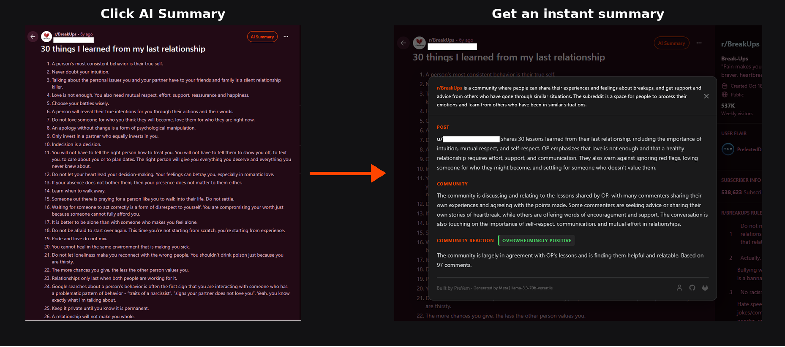
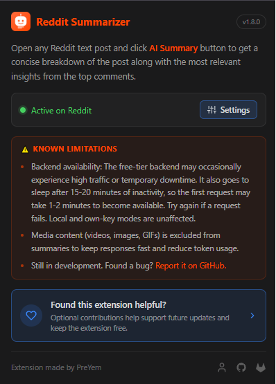
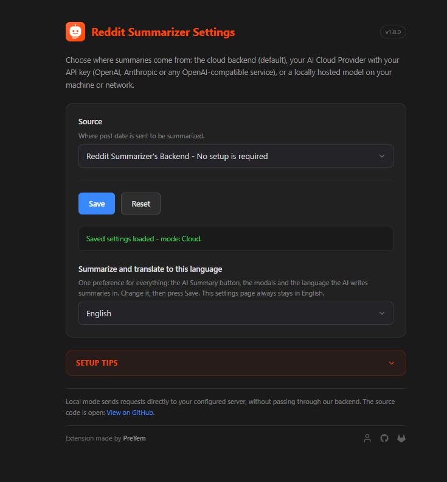

# Reddit Summarizer

**Get the gist of any Reddit thread in one click.** AI summaries of the post and its top comments, plus the community's overall reaction, written by the model _you_ choose.


[Features](#features) · [Choose your AI](#choose-where-summaries-come-from) · [Getting started](#getting-started) · [Settings reference](#settings-reference) · [Stats dashboard](#request-log-and-stats-dashboard)



| Popup                                                                | Settings page                                                                                                                    |
| -------------------------------------------------------------------- | -------------------------------------------------------------------------------------------------------------------------------- |
|  |  |

---

## Features

- **Structured summaries.** The post body in a few concise sentences, the top comments and community discussion, and a labelled reaction (Positive, Negative, Mixed, and so on).
- **Honest numbers.** Every summary ends with a localized "Based on N comments." line, rendered by the add-on from the real scraped count. The model never counts.
- **11 languages.** English, French, Spanish, German, Italian, Portuguese, Dutch, Arabic, Hindi, Japanese and Korean. _Add-on language_ localizes the interface, and _Summary language_ picks the language the AI writes in.
- **Bring your own AI.** Use the built-in cloud backend, your own OpenAI/Anthropic/custom API key, or a local server such as LM Studio, Ollama or llama.cpp. Same prompt, same structured output.
- **Every browser family.** Chromium-based (Chrome, Edge, Brave, Opera…) and Gecko-based (Firefox, Waterfox, LibreWolf…).
- **Self-hoster friendly.** The backend logs the latest 500 requests and ships with a built-in stats dashboard (see [Request log and stats dashboard](#request-log-and-stats-dashboard)).

## Choose where summaries come from

| Source                | Who runs the AI                                                     | Where your post data goes              | Setup             |
| --------------------- | ------------------------------------------------------------------- | -------------------------------------- | ----------------- |
| **Cloud** (default)   | The project's backend                                               | The backend, then one of its providers | None              |
| **AI Cloud Provider** | OpenAI, Anthropic, or any OpenAI-compatible service at your own URL | Straight to your chosen provider       | Your API key      |
| **Local server**      | Your own LLM (LM Studio, Ollama, llama.cpp…)                        | Nowhere. It never leaves your machine  | Your endpoint URL |

All three sources send the same prompt (both sides compile the shared `buildPrompt`) and expect the same 5-key JSON schema.

## Tech stack

| Part                | Built with                                                                                                                                                                                     |
| ------------------- | ---------------------------------------------------------------------------------------------------------------------------------------------------------------------------------------------- |
| **Extension**       | TypeScript and Vite, built for both Chromium and Gecko. Popup and settings use Tailwind CSS v4 compiled at build time, so there is no CDN and it works fully offline.                          |
| **Backend**         | Node.js, Express and TypeScript                                                                                                                                                                |
| **AI (cloud mode)** | Groq (`openai/gpt-oss-20b`), then Google Gemini (`gemini-2.5-flash`), then Anthropic Claude (`claude-haiku-4-5`). Each provider is tried in that order, falling back to the next if one fails. |

---

## Getting started

### Prerequisites

- Node.js 18+ and npm 8+
- API keys for the providers you want the backend to use: [Groq](https://console.groq.com/), [Google Gemini](https://aistudio.google.com/apikey) and/or [Anthropic](https://console.anthropic.com/). You only need the key for the provider you actually want to rely on.

### 1. Clone the repo

```bash
git clone https://github.com/PreYem/reddit-summarizer-preyem.git
cd reddit-summarizer-preyem
```

### 2. Run the install script

The one-time script installs dependencies for both workspaces, creates `express-backend/.env` from `.env.example`, and builds the extension for both browsers.

**Windows:** double-click `windows_install_project.bat`, or run it in a terminal:

```bat
windows_install_project.bat
```

**Linux:**

```bash
chmod +x linux_install_project.sh
./linux_install_project.sh
```

### 3. Configure the backend

Open `express-backend/.env` and fill in your own values:

```env
GROQ_API_KEY=your_key_here
GEMINI_API_KEY=your_key_here
ANTHROPIC_API_KEY=your_key_here
PORT=3000
EXTENSION_KEY=your_shared_key_here
LOG_VIEW_KEY=your_stats_dashboard_key_here
DEBUG_MODE=false
```

| Variable                                              | What it does                                                                                                         |
| ----------------------------------------------------- | -------------------------------------------------------------------------------------------------------------------- |
| `GROQ_API_KEY`, `GEMINI_API_KEY`, `ANTHROPIC_API_KEY` | Provider keys, tried in that order (Groq, then Gemini, then Anthropic)                                               |
| `PORT`                                                | Port the backend listens on                                                                                          |
| `EXTENSION_KEY`                                       | Shared secret the backend checks before rate limiting and logging. The extension must send the same value.           |
| `LOG_VIEW_KEY`                                        | Protects the request-log endpoints (`/latest-requests`, `/summary-logs`, `/summary-logs/data`)                       |
| `DEBUG_MODE`                                          | Set to `true` to return a static response with a delay, so you can test frontend features without spending AI tokens |

### 4. Build the extension

The install script already built both targets. To rebuild after code changes, run this from the `extension` directory:

```bash
npm run build        # both the Chromium and Gecko builds
```

The published version lives in the `version` field of `extension/public/manifest.chromium.json` and `manifest.gecko.json`. Bump it whenever you ship an update so browsers and stores see a new release (currently `1.8.0`).

### 5. Load the extension in your browser

**Chromium:**

1. Go to `chrome://extensions`
2. Enable **Developer mode** (top right)
3. Click **Load unpacked**
4. Select the `extension/dist/chromium` folder

**Gecko:**

1. Go to `about:debugging#/runtime/this-firefox`
2. Click **Load Temporary Add-on**
3. Select any file inside `extension/dist/gecko`

### 6. Run the backend and the extension dev server together

**Windows:** double-click `windows_start_dev_server.bat`, or run it in a terminal:

```bat
windows_start_dev_server.bat
```

**Linux:**

```bash
chmod +x linux_start_dev_server.sh
./linux_start_dev_server.sh
```

The backend starts on `http://localhost:3000` and the extension dev server watches for changes. The repo uses npm workspaces (`extension` and `express-backend`), so you can also run `npm run dev:all` from the project root.

---

## Settings reference

Open the settings page from the popup's **Open AI Settings** link or from your browser's add-on manager. It no longer opens automatically on install.

### Sources, models and saving

- **Source:** `Cloud` (default), `AI Cloud Provider` (OpenAI, Anthropic, or any OpenAI-compatible service at your own URL), or `Local server`.
- Each source shows only the inputs it needs. The **model dropdown is auto-detected** from your server's model list (`/models`, Anthropic `/v1/models`, Ollama `/api/tags`), so you never type a model name.
- **Test connection** pings the model-list route and refills the dropdown. It is hidden in Cloud mode, where there is nothing to ping.
- **Save** persists across sessions and browser restarts. Right after a successful save it grays out (tooltip: _Saved — edit a field (or model) then Test to save again_), so change a field and pass a fresh Test to save an update.
- **Reset** clears the current source's fields (endpoint, key, model, thinking) back to their empty defaults.
- Each source (OpenAI, Anthropic, other-provider URL, and each local flavor) keeps its **own saved slot**. Switching Source, Provider or flavor restores that source's key, URL and model, and never leaks another source's values.
- The **API key** is kept in extension storage only. It is sent as `Authorization: Bearer` (or `x-api-key` for Anthropic) to your configured provider and nowhere else. An eye button under the field reveals the typed key without retyping, and it hides again on every page load.

### Thinking level (Local server only)

Choose None (default, off), Low, Medium or High.

- **OpenAI-compatible servers** receive `reasoning_effort`. When thinking is off, the extension sends `reasoning_effort: "none"` plus `chat_template_kwargs: {enable_thinking: false}`, which covers gpt-oss and Qwen3 templates.
- **Ollama** receives `think: true/false`, so its dropdown only offers None and On.
- Servers that reject these fields (HTTP 400) are retried once without them.

### Languages

- **Add-on language** localizes the extension interface. **Summary language** is the language the AI writes summaries in.
- Both apply instantly and do not wait for Save or Test. Both default to a browser-language match and are stored separately in `rs_ui` (`v2`).
- Changing the summary language changes the summary cache fingerprint, so a non-English summary is never reused for an English request.
- On the wire, `SummarizeRequest.language` is only sent for a whitelisted non-English code. English or a missing language keeps the old prompt and old log traffic byte-compatible, and `communityReaction` stays canonical English on the wire even when it is localized for display.

### Behavior: caching, cancelling and errors

- Once a post is summarized, the button flips to **Show Summary**. Clicking it re-opens the modal from the page's in-memory cache with no new request. The cache is dropped when you change Source or model, so the next click re-summarizes with the new settings.
- You can cancel a running request. While the button spins it reads `Summarizing...` with a `✕ Cancel` marker and stays clickable. Clicking it (or pressing Enter again) aborts the fetch, so local servers such as Ollama and llama.cpp stop generating right away, and the button flips back to `AI Summary` for a retry.
- Requests are also cancelled automatically if you close the tab, navigate away, or leave the post mid-generation.
- If a call fails, an **error modal** opens with the same animation and ESC/✕ close as the summary modal. It shows the provider, model, error type (for example `HTTP 400 · invalid_request_error`) and the provider's own message. Nothing stays stuck on the button, and errors are never cached.
- The modal footer reads the same for every source: `Summarized by Your Local Model / Your AI Cloud Provider / Reddit Summarizer's backend in <time> | <model>.` It falls back to `Generated by <model>.` when timing is unavailable.

### Networking, permissions and local servers

- Requests run from the extension's own background page, so your server needs **no CORS headers** for the extension origin.
- In Chromium, `localhost`, `127.0.0.1`, `api.openai.com` and `api.anthropic.com` are pre-approved via `host_permissions`. Any other host gets a one-time permission prompt on Save or Test.
- **Ollama** still checks request origins. If it answers 403, start it with `OLLAMA_ORIGINS=chrome-extension://*,moz-extension://*`.
- The prompt includes up to 100 comments, so small context windows may choke small models. The extension retries once with a stricter JSON-only instruction, then shows the error. There is no silent cloud fallback.

---

## Request log and stats dashboard

Every request to `/summarize` is logged to `express-backend/data/request-log.json`, keeping the latest 500 entries so a full 90-day window survives restarts. Each entry holds the timestamp, IP, user agent, status, provider, summary language (whitelisted non-English only) and post info: title, body preview, full word count, subreddit, author and the canonical post URL. The URL is only kept when it is a real `https://*.reddit.com` link, and it renders as a clickable title in the dashboard.

While the backend is running, open the dashboard in a browser:

```
http://localhost:3000/summary-logs?key=<LOG_VIEW_KEY>
```

It shows KPIs (entries, total, average and max words, first and last entry), a daily usage chart with 7d/30d/90d ranges, status mix, provider split, hourly distribution, top subreddits, authors, IPs and user agents, and a latest-requests table, with a manual Refresh button. The key is read from `?key=` on first load, kept in `sessionStorage`, and sent as a `?key=` query param on every fetch, so no header is needed.

Raw endpoints use the same key, via the `?key=` param or the `log-view-key` header:

| Endpoint                 | Returns                                                                    |
| ------------------------ | -------------------------------------------------------------------------- |
| `GET /summary-logs/data` | Aggregated stats as JSON                                                   |
| `GET /latest-requests`   | Raw JSON log entries                                                       |
| `DELETE /summary-logs`   | Clears the log file back to an empty array (daily quota counters are kept) |

## Good to know

- The backend must be running before you use the extension, in cloud mode only. Local mode needs your own server instead.
- The extension reads the current Reddit tab. Open any Reddit post and click the injected **AI Summary** button.
- Requests are rate limited per IP, with a server-wide daily cap that resets on UTC-day boundaries. Quotas are skipped only in local debug mode.
- Daily quota counters live in `request-log.json` (`dailyCounters`), so they survive restarts and deploys. Clearing the log with `DELETE /summary-logs` does not reset them.

## Privacy, support and credits

- **Privacy:** see [PRIVACY.md](PRIVACY.md). In Local mode your post data never leaves your machine, and API keys are never collected or stored by this project.
- **Found a bug?** [Open an issue](https://github.com/PreYem/reddit-summarizer-preyem/issues).
- **Like it?** Optional contributions help support future updates and keep the extension free: [paypal.me/preyem](https://paypal.me/preyem).

Built by [PreYem](https://preyem.me/) · [GitHub](https://github.com/PreYem) · [GitLab](https://gitlab.com/PreYem)
